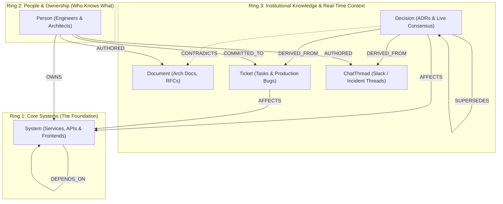

# CortexFlow: Self-Healing Company Brain

> **An autonomous, real-time, self-healing knowledge graph built on FalkorDB that eliminates organizational knowledge rot, traces decision lineage, and proactively flags downstream blockers.**

[](https://lablab.ai/)
[](https://lablab.ai/)
[](https://www.falkordb.com/)
[](https://fastapi.tiangolo.com/)
[](https://vitejs.dev/)
[](https://tailwindcss.com/)
[](LICENSE)

### Hackathon Submission Companion Assets
- 📖 **Executive Project Overview**: [PROJECT_OVERVIEW.md](PROJECT_OVERVIEW.md)
- 📝 **Hackathon Companion Article**: [Why Vector RAG Fails at Company Knowledge](WHY_VECTOR_RAG_FAILS.md)
- 🎬 **2-Minute Demo Video Recording Script**: [DEMO_WALKTHROUGH_SCRIPT.md](DEMO_WALKTHROUGH_SCRIPT.md)

---

## 1. Problem: Organizational Knowledge Rot

In high-velocity engineering organizations, critical context fractures across isolated silos:
* **Ephemeral Slack Discussions:** Architectural consensus is decided in hallway chats or incident war rooms (#eng-backend) without updating documentation.
* **Stale Architecture Docs:** Markdown files, wikis, and ADRs rot within weeks as live systems evolve.
* **Fractured Commitments:** Bug SLAs and developer promises live in issue trackers, leaving downstream teams blindsided when an upstream dependency silently degrades.
* **Lost Lineage:** When questions arise ("*Why is the Payment-API timeout 5 seconds instead of 30 seconds?*"), engineers spend hours digging through Git blame and Slack search.

**CortexFlow solves this permanently.** It ingests daily events into a live FalkorDB graph, continuously detects contradictions between active decisions and legacy docs, tracks time-sensitive commitments with downstream blast radius warnings, and auto-heals documentation with one click.

---

## 2. Zero-Mock Guarantee

CortexFlow is **not a client-side prototype or UI mockup**. Every visual component and user interaction is backed by **real Cypher queries executed against a live FalkorDB Docker container** on `localhost:6379`:

* **Zero Mock State:** Initial graph state, node counts, edges, commitments, and stale document alerts are strictly loaded via `GET /graph`.
* **Real Measured Latency:** Every Cypher execution measures actual elapsed database time with `time.perf_counter()` with sub-millisecond precision.
* **Full Cypher Transparency:** The frontend provides a 1-click **Inspect FalkorDB Cypher** viewer showing the exact openCypher string executed for every query.
* **Real Graph Mutations:** Time progression (`POST /simulate-time`), live ingestion (`POST /ingest`), and document self-healing (`POST /approve-doc-update`) execute live Cypher `SET`, `MERGE`, and `DELETE` commands directly on FalkorDB.

---

## 3. Concentric 3-Ring Graph Architecture

CortexFlow models company memory using a **Concentric 3-Ring Topology** in the `cortexflow_brain` graph:



### Ring Topology Reference
* **Ring 1: Core Systems (`System`)**
  * Critical services and applications (e.g. `Auth-Service` [Tier-1], `Payment-API` [Tier-1], `Checkout-UI` [Tier-2]).
* **Ring 2: People & Ownership (`Person`)**
  * Key engineers and architects (e.g. `Arjun Mehta` [@Arjun], `Sarah Jenkins` [@Sarah], `Rohit Verma` [@Rohit]).
  * Weighted ownership edges: `(p:Person)-[:OWNS {weight: 95}]->(s:System)`.
* **Ring 3: Decisions & Ephemeral Artifacts**
  * `Decision`: Active vs superseded architectural consensus.
  * `Ticket`: Production bugs and sprint tasks with SLA countdowns (`remaining_hours`).
  * `Document`: Technical documentation flagged `active` or `stale`.
  * `ChatThread`: Real Slack messages and incident channels.

### Key Relationship Semantics
| Edge | Source Node | Target Node | Properties | Operational Meaning |
|---|---|---|---|---|
| `CONTRADICTS` | `Decision` | `Document` | None | Flags document as `stale` when new consensus invalidates it. |
| `COMMITTED_TO`| `Person` | `Ticket` | `remaining_hours`, `due_hours`, `source_doc` | SLA countdown tracking ownership and pending deadlines. |
| `OWNS` | `Person` | `System` | `weight: int` (0–100) | Identifies who knows a system best for instant triage routing. |
| `DEPENDS_ON` | `System` | `System` | None | Enables multi-hop upstream/downstream blast radius calculation. |
| `AFFECTS` | `Ticket` / `Decision` | `System` | None | Directly marks systems as `degraded` or config-altered. |
| `DERIVED_FROM`| `Decision` | `ChatThread` / `Ticket` | None | Preserves historical consensus lineage. |
| `SUPERSEDES` | `Decision` | `Decision` | None | Chains decisions so older decisions are marked historical. |

---

## 4. Key Capabilities & Live Workflows

### A. Live Event Ingestion (`POST /ingest`)
When discussions happen in Slack, bug tickets are filed, or docs are written, CortexFlow executes Cypher `MERGE` statements to attach new context to existing systems and people without duplicating entities:
* Mentioning a system (e.g., `Payment-API`) automatically attaches `[:AFFECTS]` edges and degrades the system if it's a bug.
* Mentioning an engineer (e.g., `@Arjun`) merges an `[:AUTHORED]` or `[:COMMITTED_TO]` edge with parsed SLA hours.
* If a new decision contradicts existing docs, CortexFlow creates a `[:CONTRADICTS]` edge and marks the document `stale`.

### B. Proactive Blast Radius & Downstream Alerts
When a core service like `Auth-Service` is degraded by an open bug, CortexFlow traverses multi-hop dependency chains:
$$\text{Ticket} \xrightarrow{\text{AFFECTS}} \text{System} \xleftarrow{\text{DEPENDS\_ON}} \text{Downstream System}$$
Any downstream dependency (e.g., `Checkout-UI` and `Payment-API`) is automatically alerted before outages cascade into production.

### C. Self-Healing Documentation (`POST /approve-doc-update`)
When knowledge drift occurs:
1. The Left Panel displays the stale document with the exact contradiction reason.
2. The engineer clicks **"Approve & Auto-Heal Doc"**.
3. FastAPI executes Cypher to update the document's content, restore status to `active`, and **physically `DELETE` the `[:CONTRADICTS]` edge in FalkorDB**.
4. The graph visualizer immediately reflects the healed document state in real time.

### D. Time Decay Simulation (`POST /simulate-time`)
Fast-forward simulation clock by specified hours (+4h):
```cypher
MATCH (p:Person)-[c:COMMITTED_TO]->(b:Ticket)
SET c.remaining_hours = CASE
    WHEN c.remaining_hours - 4 < 0 THEN 0
    ELSE c.remaining_hours - 4
END
WITH p, c, b
SET b.remaining_hours = c.remaining_hours
RETURN p.name, b.name, c.remaining_hours
```
When `remaining_hours` reaches 0, SLA alerts flip to **CRITICAL OVERDUE** with red visual callouts.

### E. Role-Based Access Control (RBAC)
* **Senior Role:** Full visibility into all company systems, architectural decisions, and sensitive vulnerability reports (e.g., `Bug-999` Key Rotation Exploit).
* **Intern Role:** Any node with `sensitivity == 'restricted'` is masked with `[RESTRICTED - Security Clearance Required]`, locked in the visual graph (`#94A3B8`), and hidden from public alerts.

### F. Read-Only Cypher Security Guardrail
All queries submitted to `/ask` are inspected by an input tokenizer. Any mutating Cypher keywords (`DELETE`, `DROP`, `DETACH`, `REMOVE`, `SET`, `CREATE`, `MERGE`) trigger an immediate **HTTP 400 Security Guardrail Violation** to prevent prompt injection or graph corruption.

---

## 5. Technology Stack

* **Graph Database:** [FalkorDB](https://www.falkordb.com/) (Redis-based ultra-low-latency graph engine)
* **Backend:** [FastAPI](https://fastapi.tiangolo.com/) (Python 3.10+), [Pydantic v2](https://docs.pydantic.dev/), [falkordb-python](https://github.com/FalkorDB/falkordb-py), Uvicorn
* **Frontend:** [React 18](https://react.dev/), [Vite](https://vitejs.dev/), [Tailwind CSS](https://tailwindcss.com/), [Lucide React Icons](https://lucide.dev/)
* **Testing:** [Pytest](https://docs.pytest.org/), [FastAPI TestClient](https://fastapi.tiangolo.com/tutorial/testing/)

---

## 6. Quickstart & Installation

### Prerequisites
* [Docker Desktop](https://www.docker.com/products/docker-desktop/) running locally
* [Python 3.10+](https://www.python.org/downloads/)
* [Node.js 18+](https://nodejs.org/)

### 1. Launch FalkorDB via Docker
Run the official FalkorDB Docker container exposing port `6379`:
```bash
docker run -d --name falkordb -p 6379:6379 -v falkordb_data:/data falkordb/falkordb:latest
```

Verify that FalkorDB is responding:
```bash
docker exec -it falkordb redis-cli ping
# Expected response: PONG
```

### 2. Backend Setup
Navigate to the root directory and create a virtual environment:
```bash
python -m venv .venv

# On Windows:
.venv\Scripts\activate
# On macOS / Linux:
source .venv/bin/activate

# Install dependencies:
pip install -r backend/requirements.txt
```

Seed the baseline graph (17 nodes, 26 edges):
```bash
python backend/seed.py
```

Start the FastAPI backend server:
```bash
python -m uvicorn backend.main:app --host 0.0.0.0 --port 8000 --reload
```
The backend API is live at `http://localhost:8000` (Interactive Swagger docs at `http://localhost:8000/docs`).

### 3. Frontend Setup
In a new terminal window:
```bash
cd frontend
npm install
npm run dev
```
Open your browser to **`http://localhost:5173`**.

---

## 7. API Reference

### Overview of Endpoints

| Method | Endpoint | Description |
|---|---|---|
| `GET` | `/graph?role=senior\|intern` | Fetches all nodes, edges, active commitments, and stale docs from FalkorDB. Applies RBAC masking. |
| `POST` | `/ask` | Multi-hop Cypher traversal for natural language questions. Enforces read-only guardrail. |
| `POST` | `/ingest` | Ingests Slack chat, doc, or bug ticket into FalkorDB via Cypher `MERGE`. |
| `POST` | `/simulate-time` | Decrements `remaining_hours` on `[:COMMITTED_TO]` edges and flags overdue tickets. |
| `POST` | `/approve-doc-update` | Restores stale doc to `active` and executes `DELETE r` on the `[:CONTRADICTS]` edge. |
| `POST` | `/reset` | Re-seeds the FalkorDB graph back to the clean baseline 17-node, 26-edge state. |

---

## 8. Sample Production Cypher Queries

CortexFlow executes real openCypher queries directly on the `cortexflow_brain` FalkorDB graph. Below are the canonical queries driving each core feature:

### 1. Multi-Hop Decision Lineage & Drift Detection
Traces why an architectural parameter changed, who decided it, which tickets and chat threads derived it, and which stale documents it contradicts:
```cypher
MATCH (s:System {id: 'sys_pay'})
OPTIONAL MATCH (p:Person)-[o:OWNS]->(s)
OPTIONAL MATCH (d:Decision {status: 'active'})-[:AFFECTS]->(s)
OPTIONAL MATCH (d)-[:DERIVED_FROM]->(src)
OPTIONAL MATCH (d)-[:CONTRADICTS]->(doc:Document)
OPTIONAL MATCH (d)-[:SUPERSEDES]->(old_dec:Decision)
OPTIONAL MATCH (t:Ticket)-[:AFFECTS]->(s)
OPTIONAL MATCH (downstream:System)-[:DEPENDS_ON]->(s)
RETURN s, collect(DISTINCT p), collect(DISTINCT d), collect(DISTINCT src),
       collect(DISTINCT doc), collect(DISTINCT old_dec), collect(DISTINCT t),
       collect(DISTINCT downstream)
```

### 2. Upstream Blocker Interception & Downstream Blast Radius
When querying about `Checkout-UI`, CortexFlow traverses directed dependency edges to discover upstream blockers on `Auth-Service`:
```cypher
MATCH (s:System {id: 'sys_check'})
OPTIONAL MATCH (p:Person)-[o:OWNS]->(s)
OPTIONAL MATCH (s)-[:DEPENDS_ON*1..2]->(dep:System)
OPTIONAL MATCH (bug:Ticket {kind: 'bug', status: 'open'})-[:AFFECTS]->(dep)
OPTIONAL MATCH (bug_owner:Person)-[c:COMMITTED_TO]->(bug)
RETURN s, collect(DISTINCT p), collect(DISTINCT dep),
       collect(DISTINCT {bug: bug, owner: bug_owner, rem_hours: c.remaining_hours})
```

### 3. Temporal SLA Countdown & Fast-Forward Mutation
Decrements active commitment hours directly in FalkorDB without client-side illusions:
```cypher
MATCH (p:Person)-[c:COMMITTED_TO]->(b:Ticket)
SET c.remaining_hours = CASE
    WHEN c.remaining_hours - $hours < 0 THEN 0
    ELSE c.remaining_hours - $hours
END
WITH p, c, b
SET b.remaining_hours = c.remaining_hours
RETURN p.name, b.name, c.remaining_hours
```

### 4. Zero-Duplication Live Ingestion via MERGE
Ingests Slack discussions, incident promises, or bug tickets without duplicating nodes:
```cypher
MERGE (b:Ticket {id: $ticket_id})
ON CREATE SET b.name = $ticket_name, b.title = $title, b.status = 'open', b.kind = 'bug', b.ring = 3
WITH b
MATCH (s:System {id: $system_id})
MERGE (b)-[:AFFECTS]->(s)
WITH b
MATCH (p:Person {id: $person_id})
MERGE (p)-[:COMMITTED_TO {remaining_hours: $hours, due_hours: $hours, source_doc: $source_doc}]->(b)
```

### 5. 1-Click Autonomous Self-Healing Pruning
Physically deletes the `[:CONTRADICTS]` edge and restores the document to active status:
```cypher
MATCH (d:Decision {id: 'dec_new'})-[r:CONTRADICTS]->(doc:Document {id: 'doc_arch'})
SET doc.status = 'active',
    doc.description = 'Updated architecture doc reflecting Decision-02 consensus (5s fail-fast timeout).'
DELETE r
```

---

## 9. Verification & Test Suite

### Automated Zero-Mock Verification (`verify_database_integrity.py`)
Run the end-to-end audit script that verifies live Cypher execution across all 7 lifecycle phases:
```bash
python backend/verify_database_integrity.py
```
**Verification Pipeline:**
* **Step 1:** Seeds baseline graph via `seed_graph()`.
* **Step 2:** Directly asserts 17 nodes and 26 edges in FalkorDB.
* **Step 3:** Calls `POST /ask`, verifies multi-hop Cypher, latency (<50ms), and prompt injection guardrails.
* **Step 4:** Calls `POST /simulate-time` (+4h), verifies database mutation `remaining_hours == 0`.
* **Step 5:** Calls `POST /ingest`, verifies Cypher `MERGE` node creation and ownership edge attachment.
* **Step 6:** Calls `POST /approve-doc-update`, asserts `doc.status = 'active'` and `[:CONTRADICTS]` count == 0.
* **Step 7:** Calls `POST /reset`, verifies 17 nodes and 26 edges restored.

### Pytest Suite
Run the test suite covering RBAC, security guardrails, endpoints, and error handlers:
```bash
pytest backend/test_api.py -v
```

---

## 10. Project Structure

```
cortexflow/
├── backend/
│   ├── main.py                          # FastAPI server & Cypher query engine
│   ├── seed.py                          # Canonical seed script (17 nodes, 26 edges)
│   ├── test_api.py                      # Pytest automated test suite (10 test cases)
│   ├── verify_database_integrity.py     # End-to-end zero-mock integration verification
│   └── requirements.txt                 # Backend Python dependencies
├── frontend/
│   ├── src/
│   │   ├── components/
│   │   │   ├── Navbar.jsx               # Header with telemetry, role switcher & actions
│   │   │   ├── LeftPanel.jsx            # Live Ingestion, Commitments & Drift cards
│   │   │   ├── CenterChat.jsx           # AI Reasoning Console & Cypher inspector
│   │   │   ├── RightGraph.jsx           # Concentric 3-ring SVG visualizer
│   │   │   └── NodeInspector.jsx        # Slide-over metadata inspector
│   │   ├── App.jsx                      # Main dashboard layout & state orchestrator
│   │   ├── index.css                    # Tailwind CSS directives & custom styling
│   │   └── main.jsx                     # React entrypoint
│   ├── package.json                     # Frontend npm dependencies
│   ├── vite.config.js                   # Vite configuration
│   └── tailwind.config.js               # Tailwind CSS theme configuration
├── DEMO_WALKTHROUGH_SCRIPT.md           # 2-minute demo video recording script
├── PROJECT_OVERVIEW.md                  # Executive overview of CortexFlow
├── WHY_VECTOR_RAG_FAILS.md              # Technical companion article
├── LICENSE                              # MIT License
└── README.md                            # Project documentation
```

---

## 11. AI Disclosure Statement

In compliance with hackathon regulations:
- **Autonomous Engineering & Development**: Built with pair programming and architecture assistance via **Antigravity** (Google DeepMind Advanced Agentic Coding).
- **Conversational Synthesis**: When `GEMINI_API_KEY` is provided, **Google Gemini 2.5 Flash** synthesizes natural conversational answers strictly grounded on deterministic Cypher query results returned from FalkorDB. If an API key is not supplied, CortexFlow executes deterministic graph-grounded response formatting.
- **Zero Hallucination / Zero Mock**: 100% of graph topology, relationships, temporal countdowns, and self-healing actions are stored, modified, and queried inside **FalkorDB** via real openCypher statements.

---

## 12. License

This project is licensed under the MIT License - see the [LICENSE](LICENSE) file for details.