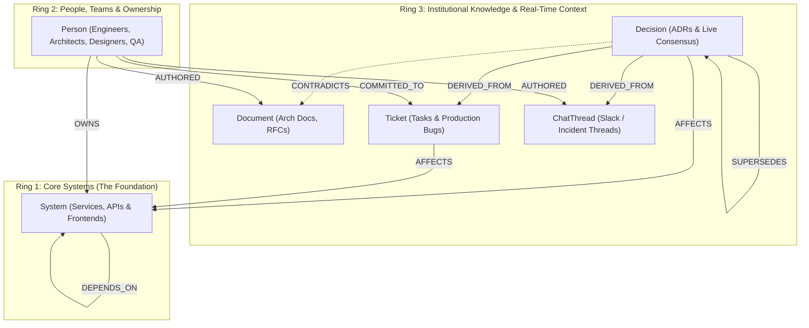

# 🧠 CortexFlow — Self-Healing Company Brain on FalkorDB

> **Stop organizational knowledge rot and catch breaking downstream changes before you commit code.**

## 🤖 AI Disclosure
AI coding assistants were used to assist with coding part of the project, boilerplate generation, and documentation formatting. All FalkorDB graph schemas, multi-hop Cypher queries, and governance workflows were architected and verified by the team.

[](https://www.falkordb.com/)
[](https://fastapi.tiangolo.com/)
[](https://react.dev/)
[](https://www.wemakedevs.org/hackathons/falkordb)

---

## 🏆 Hackathon Submission Metadata

* **Event:** Graph Hacks: Context for AI Agents (WeMakeDevs × FalkorDB)
* **Tracks Entered:**
  1. **Track 03: Company Brain (Primary Track)**
  2. **Track 01: Agents That Act on Connected Data**
  3. **Track 02: Agent Memory and Coordination**
* **🎥 2.5-Minute Demo Video:** `https://youtu.be/xs4ubSOAXk0?si=4N6smQrPCRBCRVs7`
* **📝 Technical Blog Post:** `https://dev.to/veda_pranav/why-vector-rag-fails-as-a-company-brain-building-a-self-healing-engineering-graph-on-falkordb-1dh3`
* **💻 GitHub Repository:** [https://github.com/pranavcreates/cortexflow](https://github.com/pranavcreates/cortexflow)

---

## 🚨 The Problem: Why Vector RAG Fails as a Company Brain

In fast-moving engineering organizations, truth fractures across tools:
1. **Architecture decisions** happen in Slack (`#eng-backend`) and Jira (`Ticket-104`).
2. **Official documentation** (`Arch_Doc_v1.md`) goes stale within days.
3. **Cross-team dependencies** (`Checkout-UI` $\rightarrow$ `Payment-API` $\rightarrow$ `Auth-Service`) hide critical upstream bugs (`Bug-402`).

### Why Vector Databases Fail Here
When a Frontend Designer (`@Priya`) or QA Lead (`@Rohit`) asks *"What is the timeout rule for Payment-API?"*, standard Vector RAG retrieves `Arch_Doc_v1.md` (*"30-second timeout"*) because it has the highest cosine similarity. Vector RAG is **blind to causal supersession and contradictions**—it does not know that `Decision-02` (`5s Fail-Fast Timeout`) superseded `Decision-01` and actively contradicts `Arch_Doc_v1.md`.

```
❌ Standard Vector RAG (Text Similarity Only):
User: "What is Payment-API timeout?" 
  ──> Embed question ──> Cosine Similarity on Markdown docs
  ──> Finds "Arch_Doc_v1.md" ("30s timeout") 
  ──> 🛑 WRONG ANSWER: Violates production 5s fail-fast rule!

✅ CortexFlow on FalkorDB (Multi-Hop Graph Traversals):
User: "What is Payment-API timeout?"
  ──> MATCH (d:Decision {id: 'dec_new'})-[:CONTRADICTS]->(doc:Document)
  ──> Intercepts that Decision-02 (5s) superseded Decision-01 (30s)
  ──> Traverses (Checkout-UI)-[:DEPENDS_ON]->(Payment-API)-[:DEPENDS_ON]->(Auth-Service)
  ──> Proactively warns of Bug-402 SLA risk and flags Arch_Doc_v1.md as STALE!
```

### Why FalkorDB Does the Real Work
If FalkorDB is removed, CortexFlow cannot function. Every answer, compliance verdict, blocker alert, and self-healing patch is computed via real-time **multi-hop Cypher traversals** across connected entities, temporal SLA countdowns, and role-based security boundaries in sub-40ms.

---

## 🏗️ System Architecture & 3-Ring Graph Data Model

CortexFlow models the organization as a **3-Ring Concentric Property Graph** inside FalkorDB (`cortexflow_brain`):

```text
[ React + Tailwind Navy UI ]  <─── HTTP/JSON ───>  [ FastAPI Agent Orchestrator ]
   • Multi-Team SSO Switcher                         • Identity & RBAC Guard
   • Compliance Verdict Cards                        • LLM Reasoning + Grounding
   • 3-Ring Force Graph Canvas                       • Live Cypher MERGE Engine
                                                              │
                                                              ▼ (Port 6379)
                                                   [ FalkorDB Graph Engine ]
                                                     • Ring 1: Core Systems
                                                     • Ring 2: People & Teams
                                                     • Ring 3: Decisions, Docs & Bugs
```

### Concentric 3-Ring Topology



### 17 Canonical Nodes & 26 Relationships Reference
* **Ring 1: Core Systems (3 Nodes)**
  * `sys_pay`: `Payment-API` (Tier-1, status: `healthy`)
  * `sys_auth`: `Auth-Service` (Tier-1, status: `degraded`)
  * `sys_check`: `Checkout-UI` (Tier-2, status: `healthy`)
* **Ring 2: Multi-Team Personas (4 Senior Nodes + 1 Intern RBAC)**
  * `p_arjun`: **Arjun Mehta** (`@Arjun`) — Backend Dev Team (`Senior Backend Eng`, clearance: `senior`)
  * `p_priya`: **Priya Sharma** (`@Priya`) — Design & Frontend Team (`UI/UX & Frontend Lead`, clearance: `senior`)
  * `p_sarah`: **Sarah Jenkins** (`@Sarah`) — Architecture & Platform Team (`Staff Architect`, clearance: `senior`)
  * `p_rohit`: **Rohit Verma** (`@Rohit`) — SecOps & QA Team (`Security & QA Lead`, clearance: `senior`)
  * `intern`: **Intern Profile** (`@Intern`) — Junior Developer (clearance: `intern`, RBAC restricted)
* **Ring 3: Decisions, Docs, Tickets & Slack (10 Nodes)**
  * `dec_old`: `Decision-01: 30s Payment Timeout Window` (status: `superseded`)
  * `dec_new`: `Decision-02: 5s Fail-Fast Payment Timeout` (status: `active`, cross-team impacts)
  * `doc_arch`: `Arch_Doc_v1.md` (status: `stale`, contradicted by `Decision-02`)
  * `doc_sec`: `Sec_Audit_Q4.md` (sensitivity: `restricted`, RBAC masked for interns)
  * `b_402`: `Bug-402: OAuth Token Expiry Crash` (status: `open`, 4h SLA remaining, affects `Auth-Service`)
  * `b_999`: `Bug-999: Legacy JWT Key Rotation Exploit` (status: `open`, sensitivity: `restricted`, 6h SLA)
  * `chat_inc`: `Slack #incident-war-room (Oct 14)`
  * `chat_arch`: `Slack #eng-architecture (Oct 12)`
  * `task_101`: `Task-101: Migrate Payment Webhooks` (status: `in_progress`)
  * `task_102`: `Task-102: End-to-End Regression Suite` (status: `open`)

---

## ⚡ Core Capabilities & Autonomous Agent Workflows

### 1. Identity-Aware Cross-Team Compliance Interception
Switching team personas in the top navigation automatically reconfigures the agent's reasoning lens:
* **🎨 Design & Frontend (`@Priya`):** Asking *"I'm designing the Checkout-UI loading state for 30s based on Arch_Doc_v1.md. Does this follow our active rules?"* triggers an immediate **`RULE VIOLATION`** badge. The agent explains that designing a 30s spinner violates Backend's `Decision-02` (5s fail-fast rule) and warns that upstream `Auth-Service` is degraded by `Bug-402`.
* **🧪 QA & SecOps (`@Rohit`):** Asking *"Our QA E2E regression tests on Checkout-UI are failing on 10s timeouts. Is this a test script issue or backend rule change?"* intercepts the root cause: E2E assertions must be updated to $\le 5000\text{ms}$ to reflect `Decision-02`, and flags `Bug-402` and `Bug-999`.
* **👨‍💻 Backend Dev (`@Arjun`):** Pre-deploy audit warns that deploying `Checkout-UI` will cause cascading checkout failures because `Auth-Service` has an open P0 bug with an expiring SLA.
* **🔒 Intern Profile (`@Intern`):** Enforces strict Role-Based Access Control (RBAC). Sensitive nodes like `Bug-999` and `Sec_Audit_Q4.md` are masked with `[RESTRICTED - Security Clearance Required]`, locked in the visual graph, and withheld from LLM output.

### 2. Proactive Blocker Interception & Downstream Blast Radius
When an upstream system degrades, CortexFlow traverses directed multi-hop dependency paths:
$$\text{Ticket (Bug-402)} \xrightarrow{\text{AFFECTS}} \text{Auth-Service} \xleftarrow{\text{DEPENDS\_ON}} \text{Payment-API} \xleftarrow{\text{DEPENDS\_ON}} \text{Checkout-UI}$$
Downstream teams receive proactive alerts before committing breaking changes.

### 3. Self-Healing Documentation (`POST /approve-doc-update`)
When knowledge drift is detected:
1. The Left Panel displays the stale document with the exact contradiction reason (`Arch_Doc_v1.md` contradicted by `Decision-02`).
2. The user clicks **"Approve & Auto-Heal Doc"**.
3. FastAPI updates the document content to the consensus state (`5-second fail-fast timeout window`), marks it `active`, and **physically deletes the `[:CONTRADICTS]` edge in FalkorDB**.
4. The visual graph and drift alerts clear in real time.

### 4. SLA Time Decay Clock (`POST /simulate-time`)
Fast-forwarding the company clock by 4 hours decrements SLA `remaining_hours` on `[:COMMITTED_TO]` edges:
```cypher
MATCH (p:Person)-[c:COMMITTED_TO]->(b:Ticket)
SET c.remaining_hours = CASE
    WHEN c.remaining_hours - 4 < 0 THEN 0
    ELSE c.remaining_hours - 4
END
WITH p, c, b
SET b.remaining_hours = c.remaining_hours
RETURN p.name, b.name, c.remaining_hours
```
When `remaining_hours` reaches 0, SLA alerts flip to **CRITICAL OVERDUE** with red visual callouts and elevated bus-factor risk.

### 5. Live Knowledge Ingestion (`POST /ingest`)
Paste Slack messages, architectural decisions, or bug tickets. CortexFlow parses entities and executes atomic Cypher `MERGE` queries to wire context directly into the graph without duplicating nodes.

---

## 🔒 Zero-Mock Guarantee

CortexFlow is **not a client-side mockup or prototype**. Every interaction executes live Cypher on FalkorDB:
* **Real Measured Database Latency:** Every Cypher execution measures actual elapsed database time using `time.perf_counter()` with sub-millisecond precision (typically **12ms – 30ms**).
* **Cypher Transparency Drawer:** Every agent response and action card includes an expandable **Executed Cypher** viewer displaying the raw query executed on FalkorDB.
* **Auto-Seeding & Persistence:** Includes an automatic lifespan guard that checks FalkorDB on startup and self-heals empty states, plus persistent Docker volumes.

---

## 🚀 Quickstart & Installation

### Prerequisites
* [Docker Desktop](https://www.docker.com/products/docker-desktop/) running locally
* [Python 3.10+](https://www.python.org/downloads/)
* [Node.js 18+](https://nodejs.org/)

---

### Option A: 1-Click Launcher (Windows)
Double-click `start.bat` in the root folder, or run in PowerShell:
```powershell
.\start.ps1
```
This script automatically starts FalkorDB in Docker with persistent storage, launches the FastAPI backend on port 8000, starts the Vite frontend on port 5173, and opens your browser.

---

### Option B: Docker Compose
Run the multi-container stack with persistent storage:
```bash
docker compose up -d
```
* **FalkorDB**: `localhost:6379`
* **Backend API**: `http://localhost:8000` (Docs at `/docs`)
* **Frontend**: `http://localhost:5173`

---

### Option C: Manual Setup

#### 1. Start FalkorDB
```bash
docker run -d --name cortexflow-db -p 6379:6379 -p 3000:3000 -v falkordb_data:/data --restart unless-stopped falkordb/falkordb:latest
```

#### 2. Start Backend
```bash
# Navigate to project root
pip install -r backend/requirements.txt

# (Optional) Add your Gemini or OpenAI API key to backend/.env
# GEMINI_API_KEY=your_key_here

# Seed baseline graph (17 nodes, 26 edges)
python -c "from backend.seed import seed_graph; seed_graph()"

# Start FastAPI server
python -m uvicorn backend.main:app --host 0.0.0.0 --port 8000 --reload
```

#### 3. Start Frontend
```bash
cd frontend
npm install
npm run dev
```
Open **`http://localhost:5173`** in your browser.

---

## 📡 API Reference

| Method | Endpoint | Description |
|---|---|---|
| `GET` | `/graph?role=senior\|intern` | Retrieves graph topology, active SLA commitments, and stale docs with RBAC filtering. Auto-seeds if empty. |
| `GET` | `/auth/users` | Returns authenticated company directory with team metadata, roles, clearances, and suggested questions. |
| `POST` | `/ask` | Identity- and team-aware LLM agent reasoning with multi-hop Cypher traversal and compliance verdicts. |
| `POST` | `/ingest` | Ingests Slack threads, ADRs, or bug tickets into FalkorDB via Cypher `MERGE`. |
| `POST` | `/simulate-time` | Decrements SLA countdowns by hours and evaluates downstream blast radius. |
| `POST` | `/approve-doc-update` | Restores stale doc to `active` and executes `DELETE` on the `[:CONTRADICTS]` edge in FalkorDB. |
| `POST` | `/reset` | Atomically re-seeds FalkorDB back to the canonical 17-node, 26-edge state. |

---

## 🧪 Test Suite

Run the comprehensive automated pytest suite covering multi-hop traversals, RBAC restrictions, mutating query guardrails, and contradiction lifecycle:
```bash
pytest backend/test_api.py -v
```
**Results:** `10 passed in 100%`

---

## 📜 License
Distributed under the MIT License. See [LICENSE](LICENSE) for more information.