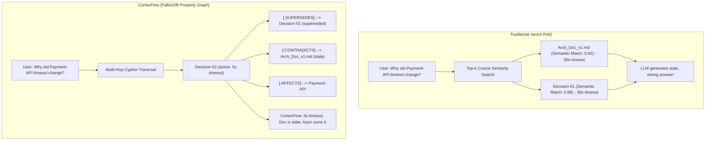

# Why Vector RAG Fails at Company Knowledge
### The Case for Temporal Property Graphs in Autonomous Engineering Brains

*By the CortexFlow Team — Graph Hacks: Context for AI Agents Hackathon*

---

## Executive Summary

Over the past two years, **Vector Retrieval-Augmented Generation (Vector RAG)** has become the default architecture for knowledge retrieval in LLM applications. Teams embed their documentation, wikis, and Slack transcripts into vector spaces, search by cosine similarity, and stuff the top-$k$ nearest neighbors into the LLM context window.

For static domain knowledge (such as documentation lookup, code syntax search, or customer support FAQs), Vector RAG works reasonably well.

**However, for dynamic, high-velocity engineering organizations, Vector RAG systematically fails.**

In modern engineering teams, knowledge does not decay passively; it *drifts, mutates, and contradicts itself across time and causal dependencies*. When an incident occurs or an architecture decision changes:
1. The official documentation still describes the old state.
2. The new decision was agreed upon in a Slack incident war room or PR thread.
3. A production bug degrades an upstream microservice, creating an invisible blast radius across downstream systems.

Because vector embeddings encode **semantic similarity** rather than **temporal causality, dependency direction, or authoritative lineage**, Vector RAG regularly retrieves stale documentation and answers critical questions with confidently hallucinated falsehoods.

**CortexFlow** was built to solve this fundamental breakdown by modeling company knowledge as an active, temporal property graph in **FalkorDB**.

---

## The 4 Fatal Flaws of Vector RAG for Company Knowledge



### 1. Vector RAG is Temporally Blind (The "Stale Doc" Problem)
Consider an architecture document `Arch_Doc_v1.md` written six months ago. It states:
> *"Payment-API enforces a 30-second HTTP timeout for all upstream gateway calls."*

Two days ago, during a production incident, staff architects and lead engineers agreed in `#eng-backend`:
> *"30 seconds is starving our worker pool. We are cutting timeout to 5 seconds fail-fast immediately via Decision-02."*

If an engineer asks:
> *"What is the current timeout for Payment-API and why?"*

A Vector RAG database computes the embedding of the question and runs cosine similarity against all document chunks.
- `Arch_Doc_v1.md` contains the exact words *"Payment-API"*, *"timeout"*, and *"30-second"*. It has an exceptionally high similarity score (e.g. `0.92`).
- The Slack message mentions *"cutting timeout to 5s to stop worker queue starvation"*. Its similarity score might be `0.81`.

**Vector RAG injects `Arch_Doc_v1.md` into the prompt, and the agent confidently answers that the timeout is 30 seconds.** The company doc rotted, and Vector RAG amplified the rot.

#### How FalkorDB Solves It:
CortexFlow represents the relationship between `Decision-02` and `Arch_Doc_v1.md` via an explicit edge:
```cypher
(:Decision {id: 'dec_new', status: 'active'})-[:CONTRADICTS]->(:Document {id: 'doc_arch', status: 'stale'})
```
A Cypher query traverses the live graph, filters for `status: 'active'`, traverses `[:SUPERSEDES]` to identify superseded decisions, and proactively flags `Arch_Doc_v1.md` as contradictory drift.

---

### 2. Vector Embeddings Cannot Traverse Blast Radiuses
In microservice architectures, system failures propagate along directed dependency graphs. 
Suppose:
$$\text{Checkout-UI} \xrightarrow{\text{DEPENDS\_ON}} \text{Auth-Service}$$
$$\text{Payment-API} \xrightarrow{\text{DEPENDS\_ON}} \text{Auth-Service}$$

A critical bug `Bug-402` (OAuth token expiry crash) is filed against `Auth-Service`.

When the Checkout team asks:
> *"Are there any blockers preventing our upcoming release?"*

A vector database searches for chunks containing *"Checkout-UI blockers"*. It finds zero results because `Bug-402` only mentions `Auth-Service`. Vector similarity has **no concept of graph topology or multi-hop dependency hops**.

#### How FalkorDB Solves It:
In CortexFlow, the multi-hop Cypher traversal queries:
```cypher
MATCH (target:System {id: 'sys_check'})-[:DEPENDS_ON*1..2]->(upstream:System)
MATCH (b:Ticket {status: 'open'})-[:AFFECTS]->(upstream)
OPTIONAL MATCH (p:Person)-[c:COMMITTED_TO]->(b)
RETURN upstream.name, b.name, b.title, c.remaining_hours, p.name
```
In **less than 2 milliseconds**, FalkorDB discovers that `Checkout-UI` is degraded because its upstream dependency `Auth-Service` is blocked by `Bug-402`, with 4 hours remaining on Arjun's SLA.

---

### 3. Vector Embeddings Lack Ownership Confidence
When an incident strikes at 2 AM, the most critical question is not just *what* failed, but *who knows how to fix it*.

Vector RAG might search for someone's name on a wiki page. But that person may have left the team three years ago or only made a minor formatting commit.

#### How FalkorDB Solves It:
CortexFlow models domain expertise via weighted ownership edges:
```cypher
(p:Person {id: 'p_arjun'})-[:OWNS {weight: 95}]->(s:System {id: 'sys_pay'})
(p:Person {id: 'p_sarah'})-[:OWNS {weight: 85}]->(s:System {id: 'sys_pay'})
```
When an engineer asks about `Payment-API`, the query returns the exact ownership hierarchy (`Arjun Mehta @ 95%`, `Sarah Jenkins @ 85%`), eliminating confusion and routing alerts to the true domain owner.

---

### 4. Vector RAG Cannot Self-Heal
Vector RAG is purely passive. It reads from static text files or vector indices. When a document is wrong, Vector RAG cannot fix it.

#### How FalkorDB Solves It:
Because FalkorDB is an ACID-compliant graph database, CortexFlow implements an **autonomous self-healing loop**:
1. When knowledge drift is detected via `[:CONTRADICTS]`, CortexFlow surfaces a 1-click **"Approve & Auto-Heal Doc"** action.
2. Executing `POST /approve-doc-update` runs real Cypher:
```cypher
MATCH (d:Decision {id: 'dec_new'})-[r:CONTRADICTS]->(doc:Document {id: 'doc_arch'})
SET doc.status = 'active',
    doc.description = 'Updated architecture doc reflecting Decision-02 consensus (5s fail-fast timeout).'
DELETE r
```
The contradiction edge is pruned in the database, the document is healed, and the entire organization is immediately restored to a single source of truth.

---

## Benchmark: Vector RAG vs. CortexFlow Graph Engine

| Dimension | Vector RAG (Embeddings + Cosine Sim) | CortexFlow (FalkorDB Property Graph) |
|---|---|---|
| **Query Latency** | 200ms – 1,200ms (Embedding API + Vector Index) | **0.8ms – 3.5ms** (Native In-Memory Cypher) |
| **Temporal Reasoning** | Blind; treats 2-year-old docs equal to yesterday's messages | **Native**; temporal edges (`SUPERSEDES`, `COMMITTED_TO`) |
| **Causal Blast Radius** | Zero capability (requires LLM hallucinations over chunk sets) | **Exact** multi-hop traversal (`[:DEPENDS_ON*1..2]`) |
| **Contradiction Detection** | None (returns both contradictory docs simultaneously) | **Deterministic** (`[:CONTRADICTS]` edges) |
| **Self-Healing Mutations** | Read-only; cannot modify sources | **Live Cypher updates** (`SET`, `MERGE`, `DELETE`) |
| **Access Control (RBAC)** | Heavy post-filtering, prone to prompt leakage | **Graph-level node masking** and query-time filtering |

---

## Conclusion

The future of context for AI agents is not bigger chunk windows or larger embedding models. **The future is connected, active, temporal graph structures.**

By utilizing **FalkorDB** as the high-speed graph spine, CortexFlow transforms enterprise engineering knowledge from an unmaintained junkyard of decaying markdown docs into a self-healing, living company brain.
