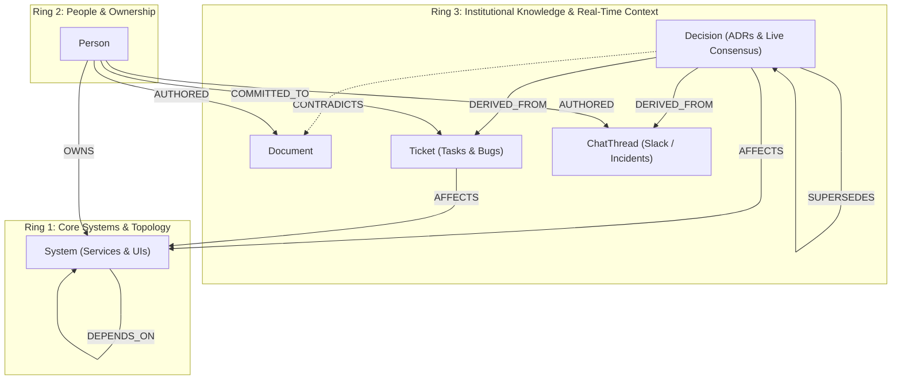

# CortexFlow: Self-Healing Company Brain

> **Hackathon Architecture Specification**  
> Graph Engine: **FalkorDB**  
> Graph Database Name: `cortexflow_brain`  
> Service Host & Port: `localhost:6379`  
> Backend: **FastAPI** (`backend/main.py`) on port `8000`

---

## 1. Overview & Vision
Modern engineering organizations suffer from **knowledge drift**: architecture documentation rots as developers make fast decisions in Slack, commit hotfixes in sprint syncs, or resolve incidents on the fly. 

**CortexFlow** solves this with a **Self-Healing Knowledge Graph** running on **FalkorDB**. It monitors commitments, maps ownership down to the component level, flags stale/contradicting architecture documentation when real-time decisions change system contracts, and proactively calculates blast radius down dependency chains.

---

## 2. Graph Topology: Concentric 3-Ring Architecture

The graph `cortexflow_brain` organizes institutional memory into three concentric rings:

---

## 3. Node Labels & Schemas

### 3.1 `System` (Ring 1)
Core services, APIs, and frontends in the company's tech stack.
* Properties:
  * `id`: Unique string identifier (e.g. `sys_auth`, `sys_pay`, `sys_check`)
  * `name`: Human-readable service name (e.g. `Auth-Service`, `Payment-API`, `Checkout-UI`)
  * `status`: `healthy` | `degraded` | `down`
  * `tier`: Criticality tier (`Tier-1`, `Tier-2`, `Tier-3`)
  * `ring`: `1`

### 3.2 `Person` (Ring 2)
Engineers, architects, and engineering managers owning systems and making commitments.
* Properties:
  * `id`: Unique string identifier (e.g. `p_arjun`, `p_priya`, `p_sarah`, `p_rohit`)
  * `name`: Full name (e.g. `Arjun Mehta`)
  * `handle`: Slack/Github handle (e.g. `@Arjun`)
  * `role`: Job title (e.g. `Senior Backend Eng`, `Frontend Lead`)
  * `team`: Team designation (e.g. `Core Infra`, `Checkout Experience`, `AppSec`)
  * `ring`: `2`

### 3.3 `Document` (Ring 3)
Architecture documents, sprint sync notes, security audits, and RFCs.
* Properties:
  * `id`: Unique string identifier (e.g. `doc_arch`, `doc_sprint`, `doc_sec`)
  * `name`: File/document title (e.g. `Arch_Doc_v1.md`)
  * `content`: Text summary or payload
  * `status`: `active` | `stale`
  * `sensitivity`: `public` | `restricted` (enables role-based access control)
  * `ring`: `3`

### 3.4 `Ticket` (Ring 3)
Tasks, sprint items, and production bugs affecting systems.
* Properties:
  * `id`: Unique string identifier (e.g. `t_104`, `b_402`, `b_999`)
  * `name`: Ticket key (e.g. `Ticket-104`, `Bug-402`, `Bug-999`)
  * `kind`: `task` | `bug`
  * `title`: Description of work or defect
  * `status`: `open` | `in_progress` | `resolved`
  * `due_hours`: Initial SLA / time commitment in hours
  * `remaining_hours`: Current remaining hours (drops to 0 when overdue)
  * `sensitivity`: `public` | `restricted`
  * `ring`: `3`

### 3.5 `ChatThread` (Ring 3)
Slack discussions, incident channels, and hallway decisions that alter reality before docs are updated.
* Properties:
  * `id`: Unique string identifier (e.g. `chat_pay`, `chat_auth`)
  * `name`: Channel name (e.g. `#eng-backend`, `#incident-auth`)
  * `content`: Decision summary or consensus excerpt
  * `timestamp`: Time description (e.g. `2 days ago`, `5 hours ago`)
  * `ring`: `3`

### 3.6 `Decision` (Ring 3)
Architectural and operational decisions representing the current source of truth.
* Properties:
  * `id`: Unique string identifier (e.g. `dec_old`, `dec_new`)
  * `name`: Identifier (e.g. `Decision-01`, `Decision-02`)
  * `title`: Decision title (e.g. `5s Fail-Fast Payment Timeout`)
  * `status`: `active` | `superseded`
  * `ring`: `3`

---

## 4. Relationship Types & Semantics

| Relationship | Source Node | Target Node | Properties | Description |
|---|---|---|---|---|
| `DEPENDS_ON` | `System` | `System` | None | Defines system dependencies; enables proactive blast-radius calculation when upstream systems degrade. |
| `OWNS` | `Person` | `System` | `weight: int` (0-100) | Confidence and primary ownership weight for routing questions and incidents. |
| `AUTHORED` | `Person` | `Document` / `ChatThread` | None | Provenance link showing who wrote the document or participated in the discussion. |
| `COMMITTED_TO` | `Person` | `Ticket` | `due_hours: int`, `remaining_hours: int`, `source_doc: str` | Time-sensitive commitment made by an engineer, linked to a source document or meeting. |
| `AFFECTS` | `Ticket` / `Decision` | `System` | None | Direct operational impact on a system. |
| `DERIVED_FROM` | `Decision` | `ChatThread` / `Ticket` / `Document` | None | Explains *why* and *where* a decision originated (decision lineage). |
| `SUPERSEDES` | `Decision` | `Decision` | None | Chains decisions, marking the predecessor as superseded. |
| `CONTRADICTS` | `Decision` | `Document` | None | Highlights drift between active decisions and outdated documentation, marking the document as `stale`. |

---

## 5. Seed Dataset (17 Nodes, 26 Edges)

The baseline graph seeds a realistic production scenario:
- **System Outage / Degradation**: `Auth-Service` is `degraded` due to open `Bug-402` (OAuth Token Expiry Crash) and restricted security issue `Bug-999`.
- **Blast Radius**: `Checkout-UI` and `Payment-API` both depend on `Auth-Service`.
- **Commitment at Risk**: `@Arjun` is committed to resolving `Bug-402` within 24 hours, with only 4 hours remaining.
- **Documentation Drift**: `Arch_Doc_v1.md` claims Payment-API has a 30s timeout, but `Decision-02` (derived from `#eng-backend` and `Ticket-104`) dropped it to 5s. `Decision-02` has a `CONTRADICTS` edge to `Arch_Doc_v1.md`, flagging it `stale`.

---

## 6. API Capabilities (`backend/main.py`)

1. **`GET /graph?role=senior|intern`**:
   - Queries entire FalkorDB graph.
   - Applies RBAC: When `role == "intern"`, masks secret titles/content on `restricted` nodes (`locked: true`), returning total hidden count.
   - Emits active commitments and stale contradicted docs.

2. **`POST /ask`**:
   - Natural language Q&A with FalkorDB Cypher queries.
   - Built-in multi-hop Cypher queries with deterministic graph reasoning.
   - Returns answer, sources, executed Cypher, traversed IDs (`highlighted_ids`), and **proactive alerts** calculating multi-hop blast radius.
   - Read-only Cypher query security guardrail (`DELETE`, `DROP`, `DETACH`, `REMOVE`, `SET` blocked).

3. **`POST /ingest`**:
   - Real-time ingestion of Slack messages, docs, or bug reports via Cypher `MERGE`.
   - Links to existing `Person` and `System` nodes and identifies documentation contradictions.

4. **`POST /simulate-time`**:
   - Decrements remaining hours on `COMMITTED_TO` edges to simulate deadline pressure and trigger overdue alerts.

5. **`POST /approve-doc-update`**:
   - Self-healing action: updates stale documentation content, sets status back to `active`, and removes contradiction edges.

6. **`POST /reset`**:
   - Resets the graph back to the clean baseline 17-node, 26-edge state.
